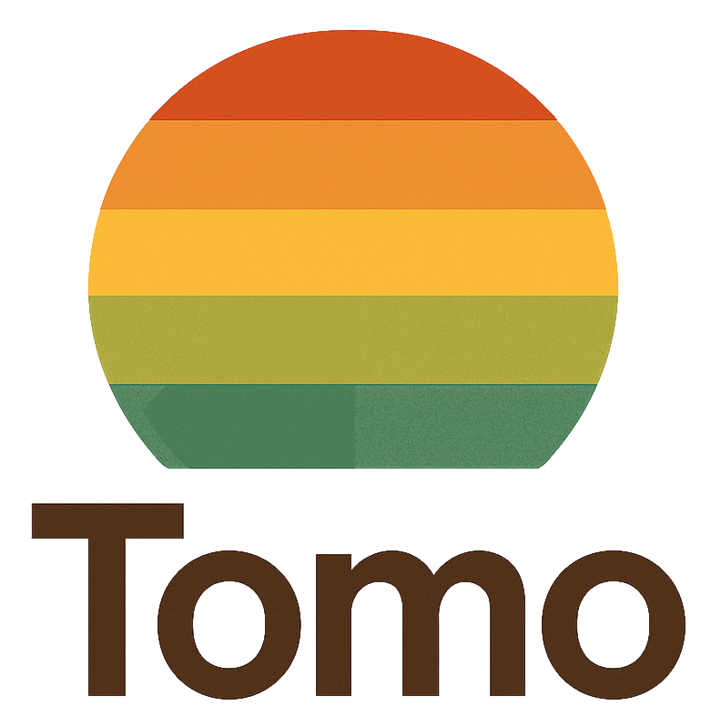

#!/usr/sbin/python3 /home/bruce/software/slides/slides.py



---

# Who am I

- I'm [Bruce Hill](https://bruce-hill.com)
- Spring 1 2025 Batch
- Currently working at [Stainless](https://stainless.com)
- Hobbyist programming language designer

---

# What am I talking about


**Tomo** is,
_and probably always will be,_
**the Language of Tomorrow!**

[tomo.bruce-hill.com](https://tomo.bruce-hill.com)

---

## Whirlwind overview

Tomo is:

- **Statically typed**
- Mostly **imperative**
  (with some borrowed functional ideas)
- **Transpiles to C**
- **Garbage collected**
- With **Python-like syntax**

Here's what it looks like:

```tomo
func sing_bottles(num_bottles:Int)
    for n in num_bottles.to(1)
        if n == 1
            say("One bottle of beer on the wall")
        else
            say("$n bottles of beer on the wall")

    say("No more bottles of beer on the wall!")

func main(n=99)
    sing_bottles(n)
```

---

# Backstory

- Not my first language ([nomsu.org](nomsu.org))
- Making languages is fun!
- Had a lot of free time in 2020 _for some reason_

Tomo grew out of my desire for a language that has the best
traits of the languages I like:

- Fast and simple (low-level like **C**)
- Ergonomic and readable (like **Python**)
- Type safety without an elaborate type system (like **Go**)

I don't think there is such a thing as a perfect language,
but I think there's room for a new balance of those values.

---

# In a nutshell

Basically, Tomo is in the same ballpark as C# or Go:
it's fast and compiled and has type safety and
automatic memory management, but I think Tomo has
a lot of improvements over Go and C#:

- Safer
- Less verbose and more expressive
- Faster compile times
- More consistent semantics
- Some neat built-in features

---

# Laundry list of features

- Garbage collection
- Type inference (but not too much)
- Sum types
- Structs
- Pointers
- Arrays
- Hash tables
- Optional types
- Fast parallel compilation
- High performance execution speed
- A module system
- Awesome strings
- Best-in-class Unicode support
- Great error messages
- Automatic command line argument parsing
- Function caching
- Integer overflow safety
- Accidental data leak prevention
- Type-safe string interpolation
- Paths as a native type
- Interoperability with C and C tooling
- No object oriented programming or generics
- Consistent reference and value semantics
- Immutability
- First class functions and lambdas
- Automatic data serialization and deserialization
- Percentages!

---

# Not this talk

But this talk is not going to be a
deep dive into any of these features.

It's also not about how the language got made.

---

# Snake

Instead, I'm going to talk about **Snake.**


You know, the classic video game!

---

# Snake

I made a little [~150 line implementation](https://github.com/bruce-hill/tomo-snek) of Snake
in the terminal using Tomo:

- Game logic is written in Tomo
- It uses a Tomo library I wrote called BTUI
  - Bruce's Text User Interface
  - It's a light wrapper around a C library I wrote
    to spit out terminal escape sequences
  - Basically, a Tomo version of ncurses, but better

I think this will be a cool showcase of some language features.

---

# Demo time

```demo
tomo ~/software/tomo-examples/snek/snek.tm
```

---

# Whirlwind code tour

```demo
nvim ~/software/tomo-examples/snek/snek.tm
```

---

# Command line arg parsing

One pretty cool feature in Tomo is that you can
provide normal arguments to the `main()` function
instead of `int main(int argc, const char *argv[])`

```
func main(snake_color|C:Color=Green, fruits|f=10)
    ...
```

```demo
nvim ~/software/tomo-examples/snek/snek.tm +12
```

---

# Command line arg parsing

With Tomo's CLI arg parsing, you even get good help messages:

```demo
cd ~/software/tomo-examples/snek/; set -x
./snek --help
ask 'Press enter to continue'
```

---

# Command line arg parsing

Let's try using the CLI flags:

```demo
cd ~/software/tomo-examples/snek/; set -x
./snek --fruits 999 --snake-color Blue
ask 'Press enter to continue'
```

---

# Command line arg parsing

CLI arg parsing even works for enums (sum types):

```demo
cd ~/software/tomo-examples/snek/; set -x
./snek --snake-color RGB 255 0 255
ask 'Press enter to continue'
```

---

# Sum types

`enum`s in Tomo are very handy for representing
things that can be one of several options, possibly
with attached data. For example, terminal Colors:

```demo
nvim ~/software/tomo-btui/btui.tm +4
```

Here's a nice example of how they are used in BTUI:

```demo
nvim ~/software/tomo-btui/btui.tm +139
```

---

# Structs and operator overloading

While we're looking at BTUI, let's look at `ScreenVec2`.

This is a 2D vector used to represent screen coordinates.

BTUI defines a nice struct to represent this, with some
math methods:

```demo
nvim ~/software/tomo-btui/btui.tm +23
```

You can see how they're used in the Snake game here:

```demo
nvim ~/software/tomo-examples/snek/snek.tm +79
```

`ScreenVec2`s also work as table keys with value semantics!

---

# Modules and C code

Stepping back a little bit, this whole game of Snake was
only possible because I had a pre-existing C library
for interacting with the terminal (BTUI).

Instead of writing a new library from scratch, I implemented
a Tomo version of BTUI using Tomo's library system and
its support for inline C code.

Tomo's build system supports building modules as shared
libraries and performing dynamic linking against them,
and I have a simple modules file to tell the compiler
where to find the code for the library:

```demo
nvim ~/software/tomo-examples/snek/modules.ini
```

Tomo makes it really nice to interact with C code,
but in a sane, safe, and ergonomic way!

---

# Summing up

I hope this has given you a little window into what
Tomo code looks like and how the features interact
with each other.

Languages can be more or less than the sum of their
parts, depending on how those features interact with
each other, and I've worked to make Tomo's features
add up to something I hope other languages will one
day envy and want to steal from.

I've built Tomo with the hope that:

- The features are easy to learn and use
- Development is **fun** and **productive**
- Code is **fast** and **correct**

I hope this demo has shown you the kind of
Tomo program you can bang together in an evening
and why it would be fun to do so!

---

# More info

If you want to learn more about Tomo:

- Come find me after the talk
- Go to [tomo.bruce-hill.com](https://tomo.bruce-hill.com)
