#!/bin/env slides

# Adversarial Interoperability

*By Bruce Hill*

-----------------------------------

# Operability

A car key and a car are made by the same
company and they operate together.

-----------------------------------

# Interoperability

|Standard           |Plug           |
|-------------------|---------------|
|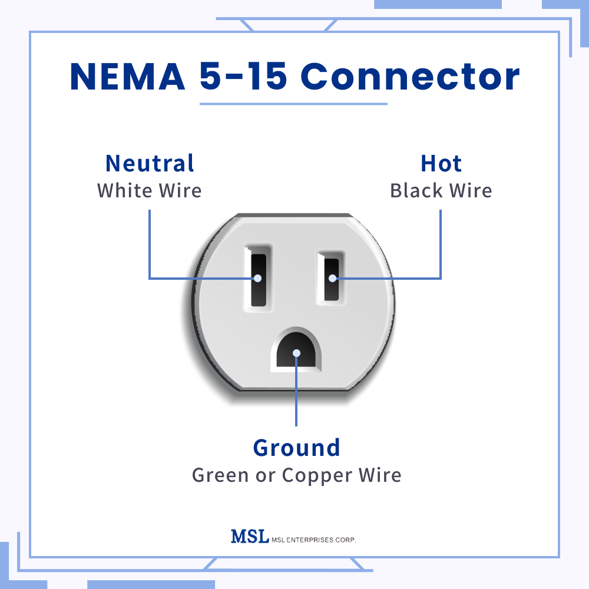 | 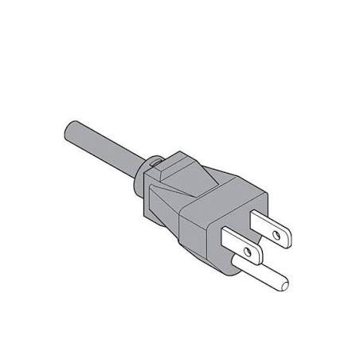 |

Outlets are designed to **interoperate** with appliances.

-----------------------------------

# Adversarial Interoperability

Car manufacturers don't want you to make your own key
copies, they want to sell you a copy.

|Adversarial              |Interoperability    |
|-------------------------|--------------------|
|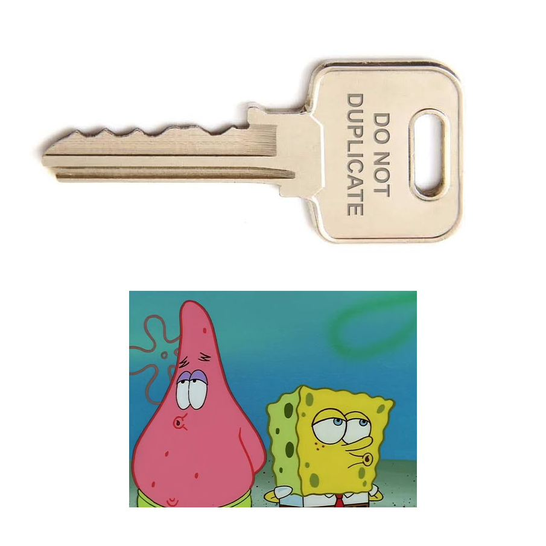||

Adversarial Interoperability is when
you make two things interoperate
when someone doesn't want you to.

-----------------------------------

# No Crimes Please

This talk is not about doing crimes!

-----------------------------------

# CFAA

- The Computer Fraud and Abuse Act
- 1986 law in the US, similar laws elsewhere

> accessed a computer without authorization or exceeding
> authorized access

"Don't access a computer without authorization!"

-----------------------------------

# DMCA

- Digital Millenium Copyright Act
- 1998 US Copyright law
- Very crap
- Anti-circumvention provision:

> No person shall circumvent a technological measure that
> effectively controls access to a work

"Don't circumvent copyright protections!"

(...except in some circumstances...)

-----------------------------------

# No Tools Either

> No person shall manufacture, import, offer to the public,
  provide, or otherwise traffic in any technology, product,
  service, device, component, or part thereof, that— (A) is
  primarily designed or produced for the purpose of
  circumventing a technological measure that effectively
  controls access to a work protected under this title;

"Don't make/distribute tools to circumvent copyright protections!"

-----------------------------------

# IANAL

I am not a lawyer.
Don't do crimes.
Don't trust me if I say something is legal.

-----------------------------------

# Pop Quiz

What do these people have in common?

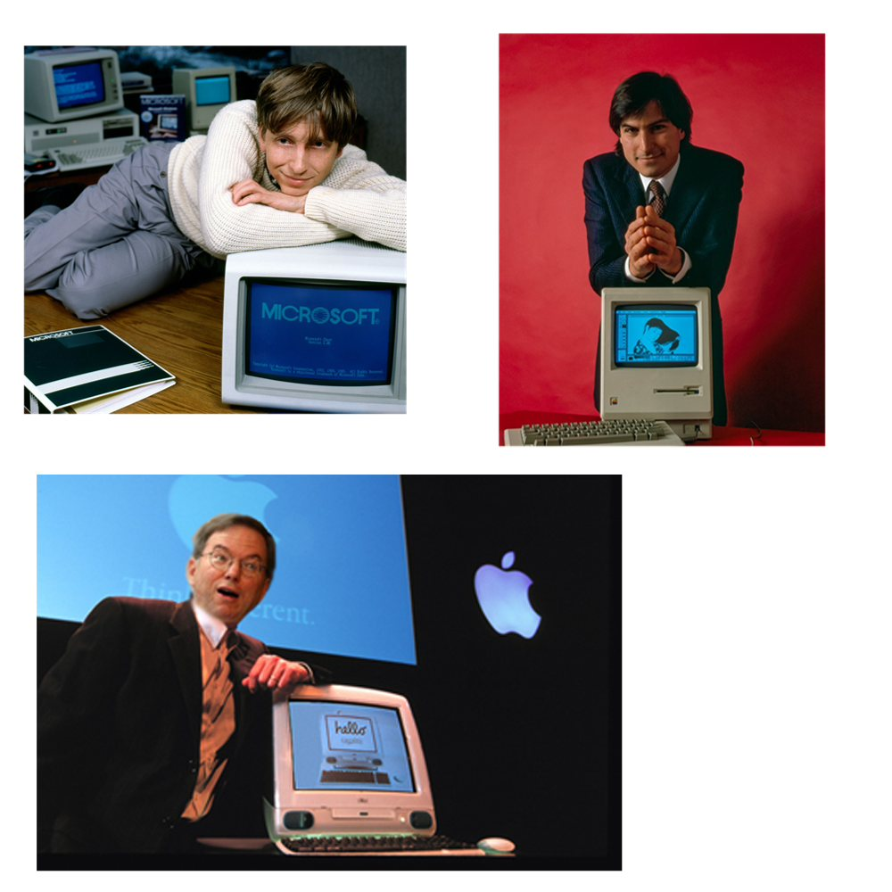

- Billionaires?
<!--pause-->
  - Sure
<!--pause-->
- Assholes?
<!--pause-->
  - I already said that
<!--pause-->
- Reptilian DNA?
<!--pause-->
  - You decide
<!--pause-->
- Correct answer: **Adversarial Interoperators**

-----------------------------------

# Case Study 1: Excel

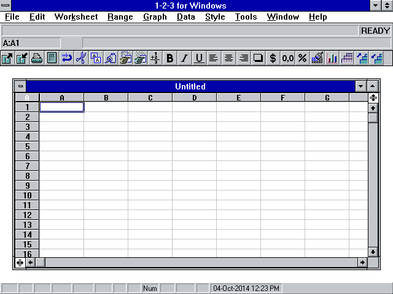

Microsoft Excel,
everyone's favorite spreadsheet program, right?

<!--pause-->

**WRONG:** This is Lotus 1-2-3

-----------------------------------

# Microsoft 1987

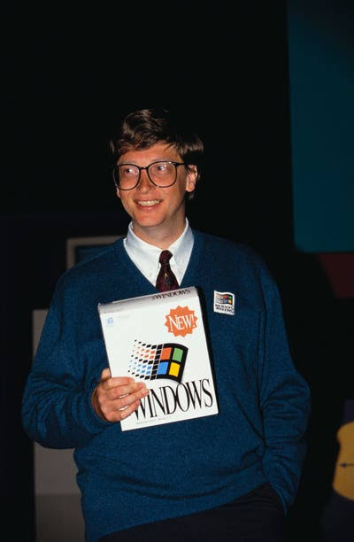

- Bill Gates was selling MS-DOS
- Getting their asses kicked by Lotus 1-2-3
- Launched Project Odyssey
- Copied Lotus 1-2-3
- Made Excel **interoperaable** with Lotus 1-2-3 files

**Adversarial interoperability**

-----------------------------------

# Result

Did Bill Gates go to jail?

*Real mugshot

-----------------------------------

# Result

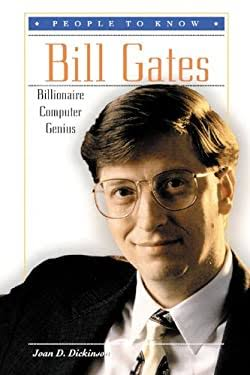

No.

<!--pause-->

*(Not yet)*

-----------------------------------

# Jobs and Work

The other guy:

<!--pause-->

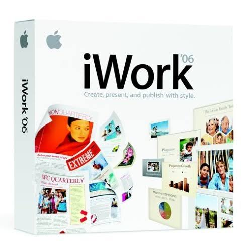

Then Apple pulled a Microsoft on Microsoft

-----------------------------------

# Google Sheets

Then Google pulled a Microsoft
on Microsoft and Apple

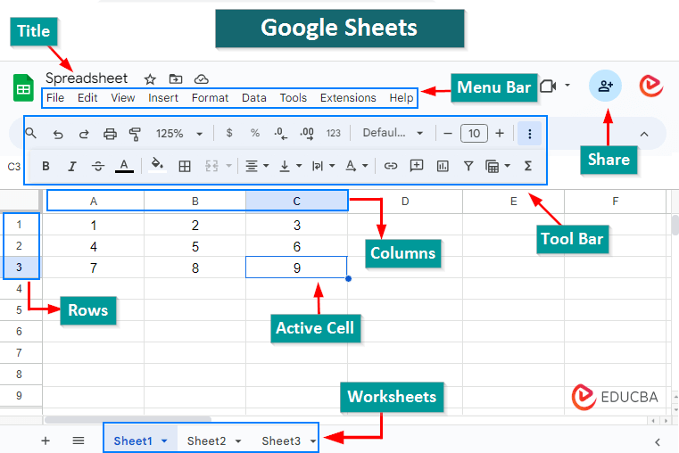

-----------------------------------

# Adversarial Interoperability

All of these spreadsheet programs succeeded because 
they took the dominant proprietary file format
and **interoperated** with it.

Lotus did not want Microsoft to use its file format

Microsoft did not want Apple or Google to use its format

-----------------------------------

# The Lesson

All of these *ahem* entrepreneurs took on an incumbent
and used interoperability to steal their market share.

This let new market entrants disrupt the dominant players.

Instead of a monopoly in spreadsheet software, we have
**competition**

-----------------------------------

# Incumbent Season

What does that mean?

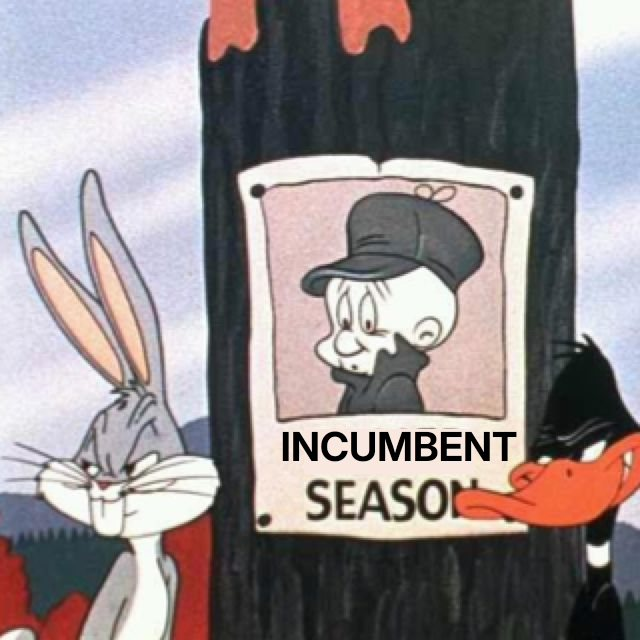

**Adversarial Interoperability is fair game!**

-----------------------------------

# Practical Terms

What incumbents do you hate,
but are stuck with?

- Microsoft Outlook?
- Facebook?
- The App Store?
- Google Play?
- Your smart TV?
- GitHub?
- Slack?
- Discord?
- Zoom?

-----------------------------------

# Why Are we Stuck?

- They have our data
- Our friends and family won't leave
- Our companies force us to use them
- They have a monopoly and bought all their competitors
- The alternatives suck
- In other words: **Switching costs are too high**

*All of these can be overcome!*

-----------------------------------

# Playbook 1: APIs

Many of these companies have **public APIs**

You can just get an API key and write a program
that interoperates with their software.

Examples:

- Slack
- Discord
- Bluesky
- YouTube

You can use this software *without using this software!*

-----------------------------------

# Example: YouTube

Hate YouTube's recommendation algorithm?

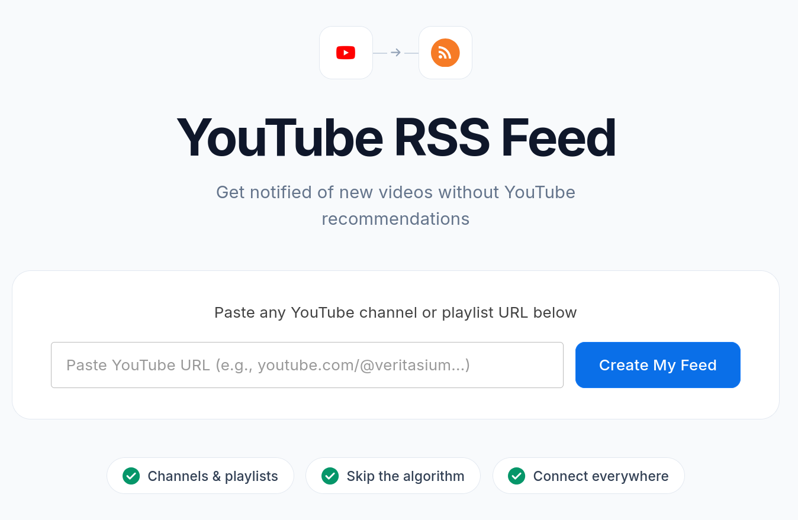

- YouTube has RSS feeds!
- They implemented it a long time ago and forgot to turn it off.
- You can just get YouTube videos in your RSS feed reader
- Never go to `youtube.com` again!

-----------------------------------

# Playbook 2: Bridges

A bridge is a piece of software that bridges the gap
between one piece of software and another:

- A tool that automatically cross-posts from one platform to another
- A tool that lets you use an alternative frontend
  - E.g. trillian
- A tool that mirrors your code to alternative hosts

-----------------------------------

# Playbook 3: Data Export

Because of the GDPR and California's CCPA:

- If you live in those jurisdictions, you have a
  **legal right** to export your data.
- Companies had to build a feature to let you export your data
- It is hard to establish legal residence
- Noncompliance is more costly than overcompliance
- You can usually export all your data even if you don't
  live in one of the cool jurisdictions

-----------------------------------

# Facebook Export Example

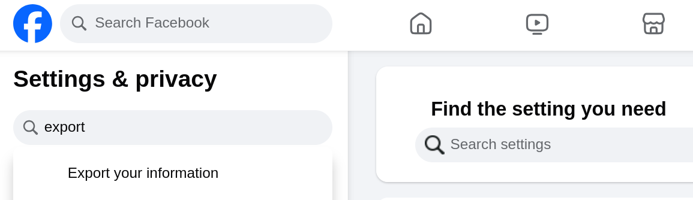
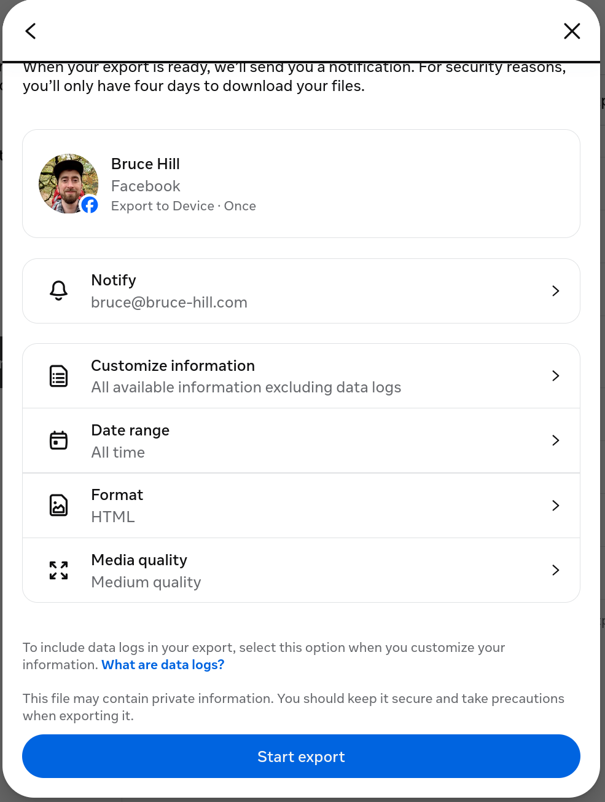

-----------------------------------

# Slack Export Example

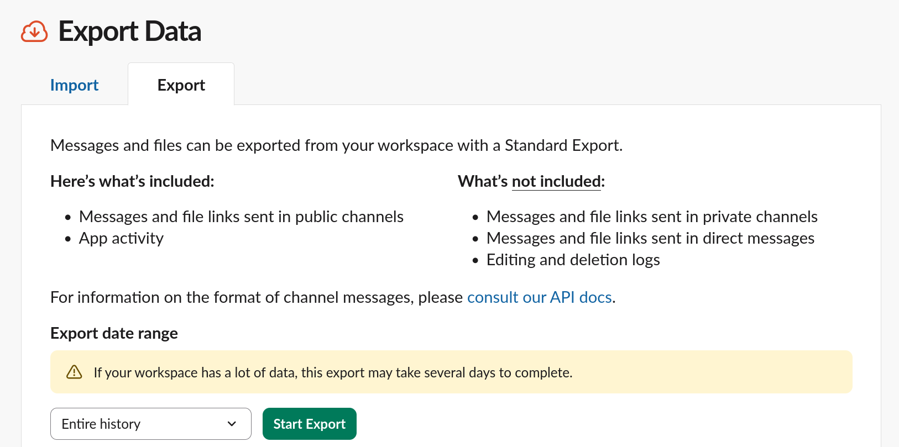

-----------------------------------

# Playbook 4: Reverse Engineering

- A lot of companies rely on **obfuscation** for security
- Reverse engineering is the process of unwinding obfuscation
- If you have a proprietary tool that can handle your data
- And you have your data
- You can work out your own way to work with your data

-----------------------------------

# Playbook 5: LLMs

It turns out LLMs are **really** good at
adversarial interop.

- Good at reverse engineering
- Good at using APIs
- Good at making projects look professional
- Good at cloning features

-----------------------------------

# Example: Photocraft

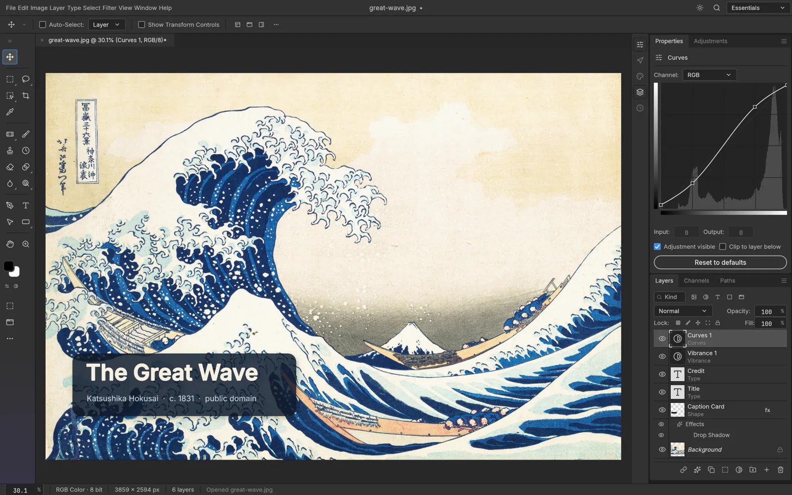

Photocraft is a feature-for-feature clone of Photoshop

Can read Adobe's PSD file format!

Someone Microsofted Adobe

-----------------------------------

# Playbook 6: Freeloading

- A lot of companies provide free or subsidized services
  - GitHub
  - Google
  - Anthropic/OpenAI
- These services can be used to host or develop
  Adversarial Interoperability projects
- Usable as a backend/backstop for your projects
  - Making a GitHub competitor? Mirror to GitHub for
  backupsy
  - Making a search engine? Scrape Google results like
    Google scrapes the web

-----------------------------------

# Go Interoperate Today

I urge all of you to consider practicing Adversarial Interop!

- The incumbents in our industry suck
- Enshittification is rampant when incumbents get too comfy
- They got to be incumbents through adversarial interop
- It's only fair play
- It's never been easier than today with LLMs
- You don't have to play nice, just play legal :)
