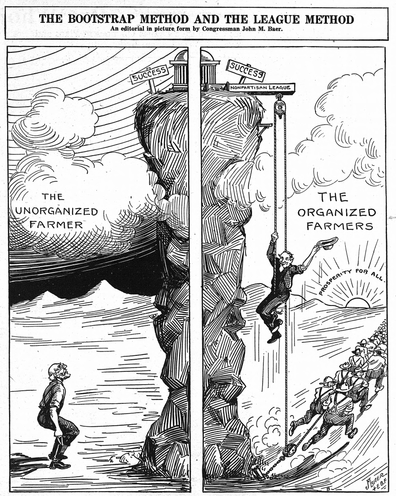
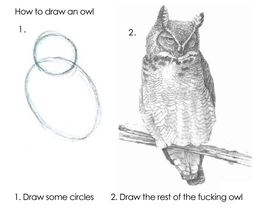

#!/bin/env slides

# Bootstrapping Metaprogramming

*How to build a language in itself
using metaprogramming*

by Bruce Hill

----------------------------------

# Bootstrapping

Pull yourself up by your bootstraps:


> The desire for "freedom of the will" [...] involves [...]
  more than Münchhausen's audacity, to pull oneself up into
  existence by the hair, out of the swamps of nothingness.
> - Nietzsche

----------------------------------

# Bootstrapping Code

*You can't actually pull yourself up by your bootstraps.*



What you actually need is to have a supportive community
that provides a baseline of resources to get you started.

In this case, that means a host language.

----------------------------------

# Nomsu

I'm going to show examples from **Nomsu**,
a language I built with natural language syntax
and very good metaprogramming capabilities.

```nomsu
(greet $someone warmly) means:
    say "Hello \$someone!"

greet "audience members" warmly
```

(It has mixfix syntax, so it looks a bit like Smalltalk.)

----------------------------------

# Compiling Nomsu

The Nomsu compiler transforms Nomsu
code into Lua code, which then runs
as a regular program.

```lua
greet_1_warmly = (function(someone)
    say(Text("Hello ", someone, "!"));
end);
greet_1_warmly("audience members");
```

----------------------------------

# Bootstrapping Metaprogramming

Nearly all of Nomsu's language constructs
are built using Nomsu code in the core library:

- Loops
- Conditionals
- Function declarations
- Variables

**Not** built into the compiler!

----------------------------------

# How do We Compile?

Looking at an AST for `(foo 123)`:

1. If there is a `COMPILE_RULES["foo"]` then call
   `COMPILE_RULES["foo"](ast)` and use the return
   value as compiled Lua code.
2. If there is no such rule, then emit `foo(...)`
   with each argument compiled.

----------------------------------

# Inline Lua Code

It all starts here:

```nomsu
lua> ("
    print("This is Lua code")
")
```

In the compiler, we define `COMPILE_RULES["lua>"]`
to be a simple function that takes a string argument
and returns that string as verbatim Lua code.

----------------------------------

# Compiles To

Using inline Lua code, I define a new action that takes
an action (a function call AST) as its first argument
and defines what Lua code that action compiles into:

```nomsu
lua> ("
    COMPILE_RULES["1 compiles to"] = function(action, body)
        local args = action:get_args()
        if body.type == "Text" then
            body = SyntaxTree{source=body.source, type="Action", "Lua", body}
        end
        return LuaCode("COMPILE_RULES[", action:get_stub():as_lua(),
            "] = ", \(\(\$args -> \$body) as lua))
    end
")
```

----------------------------------

# Metaprogramming

Now we're metaprogramming!


- Code that writes code
- E.g. macros
- Lisp is the GOAT at metaprogramming

----------------------------------

# Let's Use It

Now we can do cool stuff like this:

```nomsu
(if $condition $if_body) compiles to ("
    if \($condition as lua expr) then
        \($if_body as lua)
    end
")
```

Now we have conditionals in the language!

----------------------------------

# Parses As

From there, we can define other helpers, like a macro system
that lets us define how ASTs transform into other ASTs:

```nomsu
(unless $condition $body) parses as
    if (not $condition)
        $body
```

----------------------------------

# Building a Language



Using only these primitives and a parser, we can build an
entire programming language using the language's own syntax.

The rest is left as an exercise for the listener.
