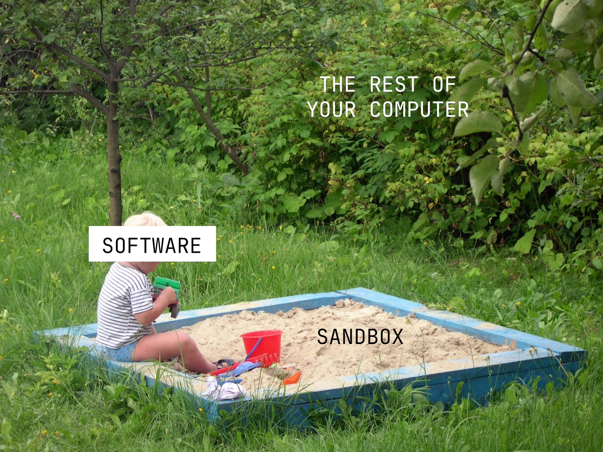
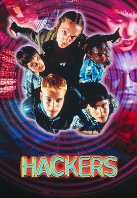
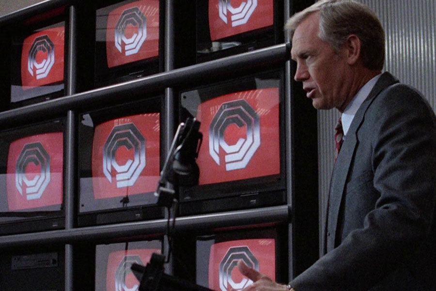
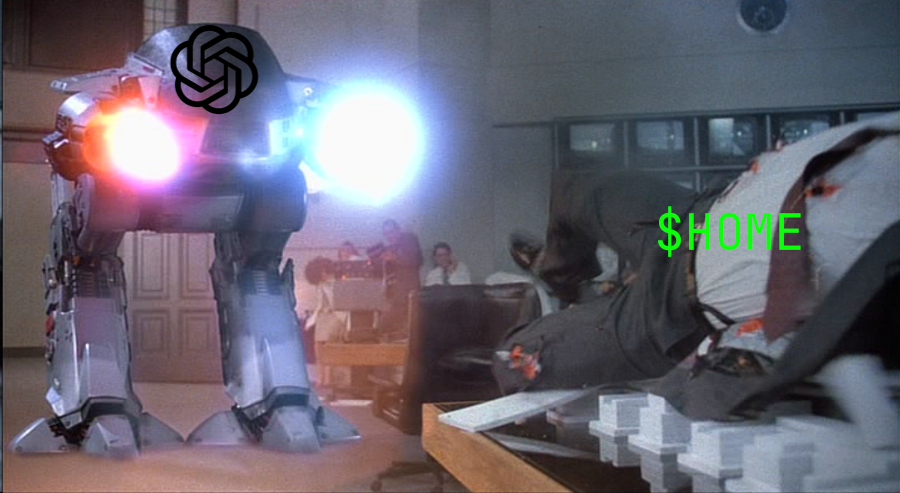
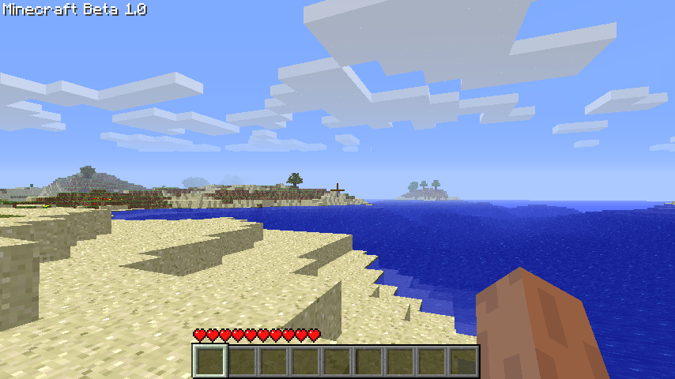
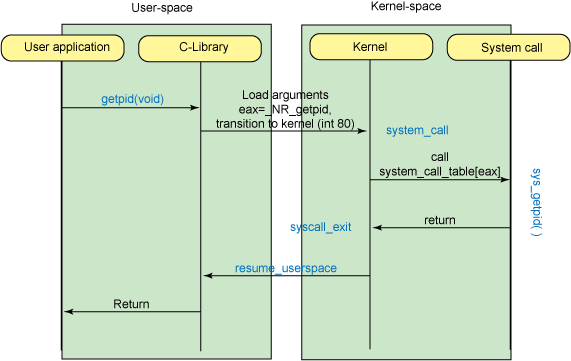
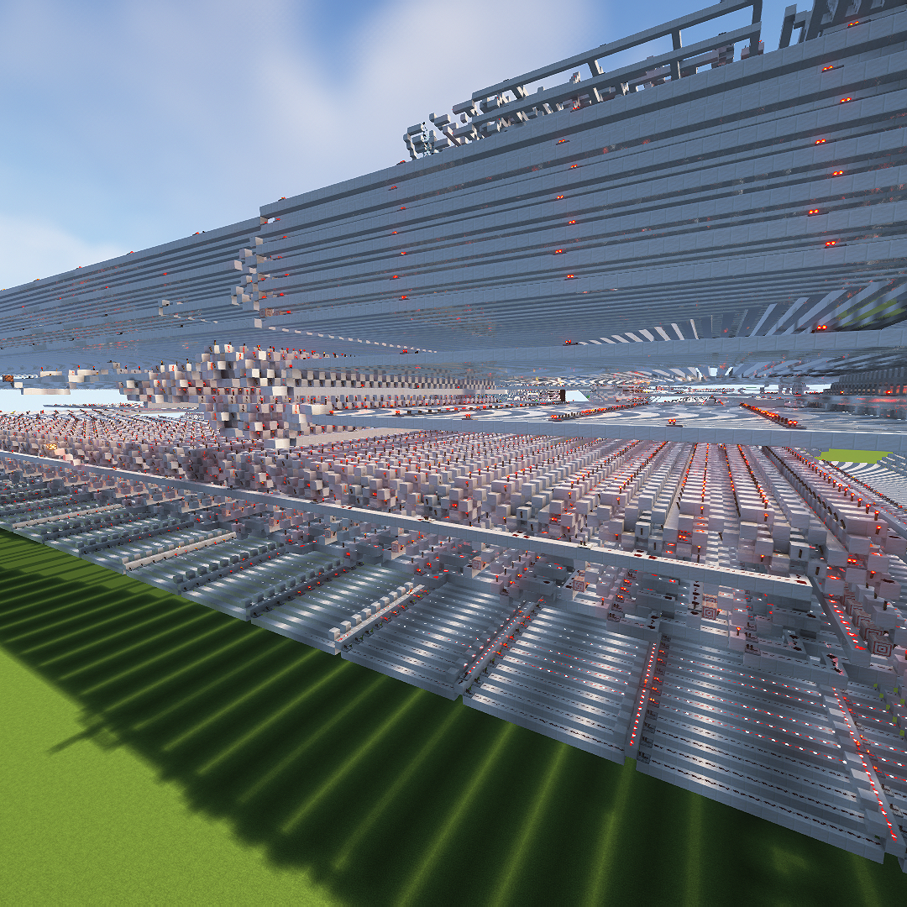

#!/bin/env slides

# Sandboxes in Sandboxes

*by Bruce Hill*

-------------------------------

# What is a Sandbox?



-------------------------------

# Threat Model

Sandboxes protect against:


Hackers

<!--pause-->


Hacker AIs

-------------------------------

# Threat Model

Sandboxes protect against:


Evil corporations

<!--pause-->


Evil AIs

<!--pause-->


Malfunctioning AIs made by evil corporations

-------------------------------

# What I"m not Covering

- Mobile apps
<!--pause-->
- Web browsers
<!--pause-->
- Sandbox games



-------------------------------

# What I Am Covering

- Linux sandboxing with seccomp
- Docker
- Mac sandboxing with Seatbelt
- System Virtual Machines
- Process Virtual Machines

-------------------------------

# Basic Sandbox Principle

**Define what a program can do,
and don't let it do anything else.**

- A buggy program can't do anything it shouldn't by accident
- A malicious program's impact is limited
- Exploiting an insecure program has limited impact

-------------------------------

# Principle of Least Privilege

A program should have the minimal set of permissions
necessary to do its job and nothing more.

- A web server should not be able to install software
- Downloading a javascript package should not give root
- Zoom should not know if you have Teams installed
- Claude should not be able to read your SSH keys

-------------------------------

# Permission Categories

Okay, so what do we care about limiting?

- Granular filesystem read/write access
- Network access
- `setuid`
- `fork()`/`exec()`
- System call primitives

-------------------------------

# seccomp

On Linux, we have `seccomp`

- "Secure Computing"
- Introduced in 2005
- Lets you define granular permissions
- Restrictions are **inherited**
- One-way valve

-------------------------------

# seccomp example

```c
#include <seccomp.h>

int main(int argc, char **argv) {
    // Allow everything:
    scmp_filter_ctx ctx = seccomp_init(SCMP_ACT_ALLOW);
    // Except sockets:
    seccomp_rule_add(ctx, SCMP_ACT_ERRNO(EPERM), SCMP_SYS(socket), 0);
    // Load the filter:
    if (seccomp_load(ctx) < 0) return 1;
    // Run a program:
    execvp(argv[1], argv + 1);
}
```

-------------------------------

# Quick tangent: syscalls



- Syscalls halt your program
- Load args into registers
- Give control to the kernel
- Kernel figures out what to do with args
- Kernel looks at your seccomp policy

-------------------------------

# seccomp and syscalls

So basically, no program can truly access the filesystem
<!--pause-->
or create a socket
<!--pause-->
or fork a process
<!--pause-->
or exec

<!--pause-->

*"Please sir, may I have a file descriptor?"*

It has to ask the kernel
and the kernel enforces security policies

-------------------------------

# OverlayFS

On Linux, you can create an **overlay** filesystem

- Create a read-only view of some parts of the filesystem
- Hide other parts
- Allow writes to a writable directory that pretends to be
  the real filesystem
- Done using the `mount` syscall
- Tell the kernel "when I read `/here`, I actually just want
  a readonly view of `/there`"

Very useful, kinda like being stuck in a dream:

- Based on reality
- But anything youu change in a dream doesn't change reality
- Can use `pivot_root` on top of this

-------------------------------

# `chroot` jails


The nuclear option, no subtlety:

- Make a directory holding a full filesystem
- Run a program so it thinks that directory is the actual
  filesystem root
- No access to any part of your filesystem outside that dir
- Have to copy every frickin file the program needs
- Very annoying

-------------------------------

# Docker

Docker is just a giant bloated pile of code on top of:

- `seccomp`
- `pivot_root`
- On Mac/Windows, a Linux VM
- I dunno, six hairdryers and the entire U2 discography?

-------------------------------

# Flatpak

- Also a seccomp/mount wrapper
- Distribute an application with a permissions manifest
- Trying to be like a mobile app, but on linux
- Tbh, haven't used it much

-------------------------------

# Bubblewrap

Bubblewrap (`bwrap`) is way cooler and lighterweight:

- Simple command line program
- Wraps a single command
- Easy to understand CLI args (or config files)
- Calls seccomp/mount and exec for you
- No perceptible startup cost

-------------------------------

# `bwrap` example

```bash
curl 'sketchy.example.com' | \
bwrap \
  --ro-bind / / \
  --dev /dev \
  --proc /proc \
  --tmpfs /tmp \
  --tmpfs "$HOME" \
  --unshare-all \
  --share-net \
  bash
```

-------------------------------

# `bwrap` example 2

Don't let your coding agent read your SSH keys:

```
safe-claude() {
  bwrap \
    --dev-bind / / \
    --tmpfs "$HOME/.ssh" \
    --unsetenv SSH_AUTH_SOCK \
    claude "$@"
}
alias claude='safe-claude'
```


-------------------------------

# Seatbelt on Mac

On Mac, the situation is a bit more dire:

Safest option: run a Linux VM

But there's also Seatbelt.

-------------------------------

# What is Seatbelt

Seatbelt is a janky, undocumented kernel feature on MacOS

- It uses "SBPL" (SandBox Profile Language)
- A janky Scheme dialect
- Undocumented
- Hackers figured out it exists
- Hackers wrote [documentation](https://reverse.put.as/wp-content/uploads/2011/09/Apple-Sandbox-Guide-v1.0.pdf) for it
- This is how Apple does sandboxing
- Officially deprecated tool `sandbox-exec`
- Still works!
- Basically `bwrap` for Mac
- Slightly worse in some ways, but mostly the same

-------------------------------

# System Virtual Machines

Now, you might be thinking,

> Why don't I just put the untrusted software in a
> virtual machine?

Virtual machines are cool!

...but also very cumbersome

- Take up a lot of disk space
- Need to have a kernel running
- Tricky to manage access to/from your real FS
- Not representative of your actual OS

-------------------------------

# Process Virtual Machines

Okay, but what about virtual machines like the JVM,
Lua VM, Javascript, etc?

These are called "process virtual machines", because
they run in a process and that process manages the
permissions instead of the kernel.

Basic idea:
- Interpret bytecode that does things that stay entirely
  within the virtual machine (loops, variables, etc)
- Limited number of access points to the world outside the VM
- Run checks on the ways the program accesses the outside
- Disallow bad things, allow benign things

-------------------------------

# Process VM Strengths

Process virtual machines are **great** for
cross-platform compatibility.

You just have to write a VM program with a couple
of shims for each new platform.

Also great for programming environments that don't
need a lot of outside access.

Great for embedded scripting languages.

-------------------------------

# Process VM Weaknesses

- A bug in the VM code, can lead to remote code execution.
  - E.g. a buffer overflow in the VM interpreter.
- Performance overhead of interpreting bytecode
  - Can be mitigated with JIT

-------------------------------

# Solution

**Sandbox the sandbox**

Run your process VM inside `bwrap`

<!--pause-->

Run that inside a Linux VM

<!--pause-->
Run that inside Mincraft

